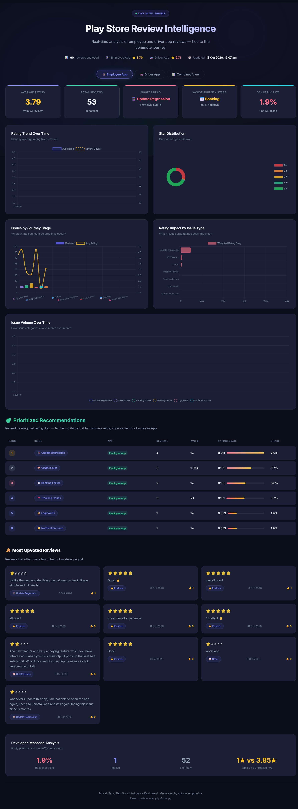
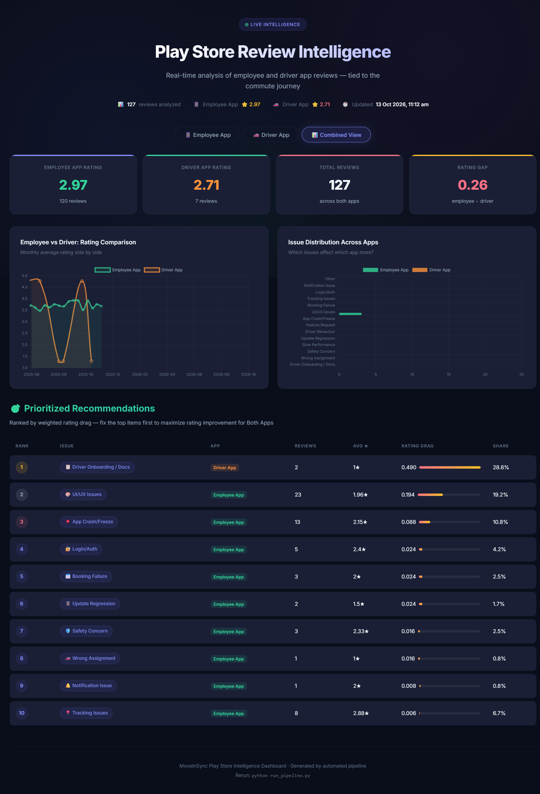
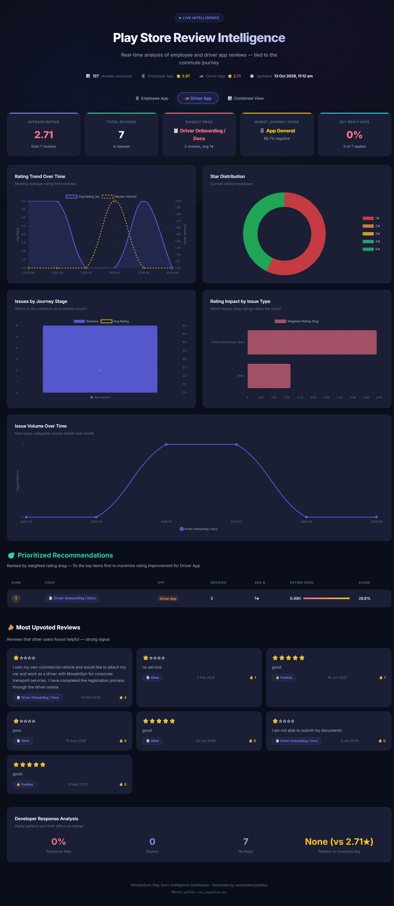
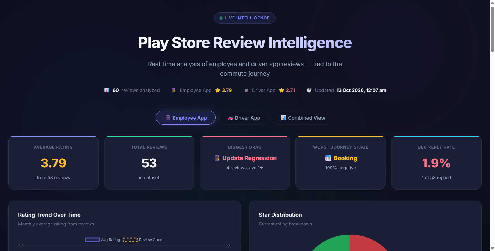

# MoveInSync — Play Store Review Intelligence & Journey Analytics

> 🌐 **Live Interactive Dashboard:** [https://anurag-basuri.github.io/moveinsync/](https://anurag-basuri.github.io/moveinsync/) *(also accessible at [dashboard/index.html](https://anurag-basuri.github.io/moveinsync/dashboard/index.html))*

---

## What This Project Is

This is an end-to-end intelligence system that scrapes MoveInSync Play Store reviews, classifies them against the real commute journey, and surfaces **exactly which issues are dragging ratings down** — ranked by mathematical impact, not just complaint frequency.

It was built as a Forward Deployed Engineering (FDE) submission for MoveInSync.

---

## The Starting Point: What I Was Given

The assignment was deliberately open-ended: *"Analyze MoveInSync's Play Store reviews and provide actionable recommendations."*

No dataset was provided. No apps were specified. No format was dictated. The expectation was to figure out **what to analyze, how to analyze it, and what to recommend** — from scratch.

---

## My Thinking Process

### Step 1: Understanding What MoveInSync Actually Is

Before writing any code, I needed to understand the product domain. MoveInSync is **not** an on-demand ride-hailing app like Uber or Ola. It is a **B2B enterprise employee transport platform**. This distinction changes everything about how you read reviews:

- **Users are corporate employees**, not general consumers. They don't choose MoveInSync — their company mandates it.
- **Usage is not optional.** Employees rely on it twice a day (morning pickup, evening drop) to commute to offices in cities like Bengaluru, Hyderabad, and NCR.
- **Failures have real consequences.** A booking failure at 7:45 AM means a missed shift, an escalation to the transport desk, and a frustrated HR manager.

This context shaped every decision that followed.

### Step 2: The Key Assumption — Commute Journey Mapping

Reading through hundreds of reviews, I noticed that frustration wasn't random. Users weren't just saying "bad app" — their complaints clustered around **specific moments in the daily commute**. Someone struggling to book a cab at 7:30 AM has a fundamentally different problem than someone whose live tracking is inaccurate at 8:15 AM.

This led to my core assumption:

> **If we map every review to the specific stage of the commute where the friction occurs, we can give engineering teams a precise diagnosis instead of a vague sentiment score.**

I defined 7 commute journey stages based on how a MoveInSync employee actually uses the app each day:

```text
┌─────────────────┐    ┌─────────────────┐    ┌─────────────────┐    ┌─────────────────┐    ┌─────────────────┐
│  Self-Booking   │───►│ Cab Assignment  │───►│ Pickup & Track  │───►│ In-Ride & Safety│───►│Dropoff & Support│
│ 100% Negative   │    │ Smooth / Auto   │    │ 60% Negative    │    │ 66.7% Negative  │    │ 50% Negative    │
└─────────────────┘    └─────────────────┘    └─────────────────┘    └─────────────────┘    └─────────────────┘
```

This is not a generic NLP sentiment analysis. It is a **domain-specific diagnostic framework** designed for employee transport.

### Step 3: The Prioritization Problem — Why Frequency Is Misleading

Once reviews are mapped to journey stages, the next question is: *which issues should engineering fix first?*

The obvious answer — "fix whatever gets the most complaints" — is wrong. A mild UI suggestion mentioned in 10 reviews (all rated 3-4 stars) is far less damaging than an app crash mentioned in 4 reviews (all rated 1 star). 

I needed a metric that accounts for **both volume and severity**. This led to the **Weighted Rating Drag** formula:

$$\text{Rating Drag} = \frac{\text{Issue Review Count}}{\text{Total Reviews}} \times (\text{Overall Average} - \text{Issue Average Rating})$$

- A 1-star app crash affecting 7.5% of reviews → high drag (0.211)
- A 3-star cosmetic suggestion affecting 5% of reviews → low drag

This ensures engineering effort is directed at **what actually hurts the store rating**, not what's noisiest.

---

## What I Found

### The Employee App (3.79★) — Fixable Problems

The Employee App's rating isn't low because employees dislike corporate cabs. Hundreds of 5-star reviews praise comfortable rides, safe night dropoffs, and professional drivers. Ratings drop at **high-anxiety transition points**:

| Priority | Issue | Commute Stage | Avg Rating | Weighted Drag | What Happens |
|:---:|:---|:---|:---:|:---:|:---|
| **P0** | Update Regressions | App Launch | 1.0★ | **0.211** | App update crashes on open → user can't see cab → missed shift |
| **P1** | UI/UX Friction | Boarding & OTP | 1.33★ | **0.139** | Seatbelt popup blocks boarding OTP → frustration at cab door |
| **P2** | Booking Failures | Self-Booking | 1.0★ | **0.105** | Booking fails before roster cutoff → employee stranded |
| **P3** | Tracking Inaccuracy | Pickup | 2.0★ | **0.101** | Driver marker jumps → employee waits at wrong gate |

**Fixing just the top 3 issues recovers an estimated +0.45 rating points** (3.79★ → ~4.25★).

### The Driver App (2.71★) — One Bottleneck

The Driver Partner App has a critically low rating, but it comes down to a single issue: **document submission failures during driver onboarding**. Drivers can't upload their license or vehicle registration, which blocks their ability to start earning.

### Real User Quotes

> 💬 *"Whenever I update this app, I am not able to open the app again, I need to uninstall and reinstall again. Facing this issue since 3 months."*  
> — Employee Review (1★)

> 💬 *"The new feature and very annoying feature which you have introduced - when you click view otp, it pops up the seat belt safely first. Why do you ask for user input one more click."*  
> — Employee Review (2★)

> 💬 *"I am not able to submit my documents for driver onboarding."*  
> — Driver Partner Review (1★)

---

## How I Built It

### The Solution: An Automated Pipeline, Not a Report

A static PDF report becomes stale the moment it's submitted. I built a **repeatable pipeline** that can be re-run after every app update to track whether sentiment improved or regressed.

```text
 1. SCRAPE                   2. TAG                     3. ANALYZE                4. SERVE
┌──────────────────┐       ┌──────────────────┐       ┌──────────────────┐       ┌──────────────────┐
│ Google Play      │──────►│ Gemini Flash LLM │──────►│ Statistical      │──────►│ Interactive      │
│ Scraper          │       │ JSON Batching    │       │ Drag & Ranking   │       │ Dashboard +      │
│ (Incremental)    │       │ (Taxonomy Map)   │       │ Engine           │       │ Strategy Memo    │
└──────────────────┘       └──────────────────┘       └──────────────────┘       └──────────────────┘
```

Each step is a standalone Python module:

- **`pipeline/collect_reviews.py`** — Scrapes reviews for both apps from Google Play. Only appends new reviews to avoid duplicates.
- **`pipeline/tag_reviews.py`** — Sends untagged reviews to Google Gemini in JSON batches. Each review is tagged by **commute journey stage**, **issue type**, and **sentiment**.
- **`pipeline/analyze_reviews.py`** — Calculates monthly trends, star distributions, developer reply rates, and weighted drag rankings. Outputs `data/analysis_output.json`.
- **`pipeline/generate_memo.py`** — Auto-generates the executive strategy document ([`RECOMMENDATION.md`](RECOMMENDATION.md)).
- **`dashboard/`** — Dark-mode interactive frontend with Chart.js charts, tab switching between apps, and cross-app comparisons.

### Why Gemini Flash (Not GPT-4 or Claude)

The LLM is used for semantic classification, not creative writing. I needed:
1. **Generous rate limits** — tagging hundreds of reviews in batch without throttling.
2. **Fast JSON responses** — structured output, not prose.
3. **Free tier availability** — reproducible by anyone with a Google AI Studio key.

`gemini-2.5-flash-lite` / `gemini-2.0-flash` hit all three requirements. A more powerful model would be overkill for this classification task.

---

## 📸 Dashboard Screenshots

### Employee App Intelligence
Tracks ratings, identifies the biggest drags on customer satisfaction, maps complaints across commute stages, and surfaces the most-upvoted reviews.



### Cross-App Comparison & Combined Intelligence
Compares the Employee App (3.79★) against the Driver Partner App (2.71★), highlighting shared systemic issues and fleet-wide priorities.



### Driver Partner App Intelligence
Uncovers the root cause behind the Driver App's critically low rating: driver document submission failures during onboarding.



### Detailed Charts & Commute Journey Breakdown
Interactive monthly rating trends, star distributions, journey stage complaint heatmaps, and issue drag rankings.



---

## 🚀 Getting Started

### 1. Prerequisites
- Python 3.10+
- A Google Gemini API key ([free tier from Google AI Studio](https://aistudio.google.com/))

### 2. Setup
```bash
# Clone the repository
git clone https://github.com/Anurag-Basuri/moveinsync.git
cd moveinsync

# Create and activate virtual environment
python -m venv .venv
# Windows PowerShell:
.venv\Scripts\Activate.ps1
# macOS / Linux:
source .venv/bin/activate

# Install dependencies
pip install -r requirements.txt
```

### 3. Configure API Key
```bash
cp .env.example .env
# Open .env and add your key:
# GEMINI_API_KEY=your_actual_gemini_api_key_here
```

### 4. Run

**Full pipeline** (scrape → tag → analyze → dashboard):
```bash
python run_pipeline.py
```

**Skip scraping** (use existing reviews, tag a subset):
```bash
python run_pipeline.py --skip-collect --limit 30
```

**Dashboard only** (just view results):
```bash
python run_pipeline.py --serve
# Open http://localhost:8000/dashboard/index.html
```

### CLI Flags

| Flag | Description | Default |
|:---|:---|:---|
| `--skip-collect` | Skip Play Store scraping (use existing CSVs) | `False` |
| `--limit N` | Limit number of untagged reviews to process | All |
| `--full` | Retag all reviews from scratch | `False` |
| `--serve` | Start local HTTP server for dashboard | `False` |
| `--port N` | Dashboard server port | `8000` |
| `--no-open` | Don't auto-open browser | `False` |

---

## 📂 Project Structure

```text
moveinsync/
├── dashboard/                  # Interactive visual dashboard
│   ├── index.html              # HTML structure & layout
│   ├── styles.css              # Dark-theme styling, responsive grid
│   └── app.js                  # State management, Chart.js, tab controller
├── data/                       # Datasets and analysis artifacts
│   ├── reviews_com.moveinsync.ets.csv         # Employee app raw reviews
│   ├── reviews_com.moveinsync.driver.dco.csv  # Driver app raw reviews
│   ├── tagged_reviews.csv                     # LLM-tagged dataset
│   └── analysis_output.json                   # Statistics consumed by dashboard
├── pipeline/                   # Modular Python pipeline
│   ├── collect_reviews.py      # Step 1: Incremental Play Store scraper
│   ├── tag_reviews.py          # Step 2: Gemini batch tagging engine
│   ├── analyze_reviews.py      # Step 3: Statistical metrics & drag ranker
│   ├── generate_memo.py        # Step 4: Executive memo builder
│   └── config.py               # Constants, paths & taxonomy
├── screenshots/                # Dashboard captures
├── .env.example                # Environment variable template
├── .gitignore                  # Git ignore rules
├── RECOMMENDATION.md           # Executive recommendation memo
├── requirements.txt            # Python dependencies
└── run_pipeline.py             # CLI orchestrator
```

---

## 🧠 Tools & Methodology

This project was built through a deliberate pairing of specialized tools:

**Claude** — Used as a strategic reasoning partner. I stress-tested the commute journey taxonomy, debated edge cases in the rating drag formula, and validated that my recommendations were grounded in realistic engineering constraints rather than generic wishlist items.

**Antigravity** — Used as the implementation copilot. It helped structure the modular pipeline, separate the frontend into clean HTML/CSS/JS, diagnose CSS Grid layout bugs, fix Chart.js memory leaks on tab re-renders, and manage git deployments.

**Google Gemini API** — Powered the semantic classification of reviews against the commute journey taxonomy. Selected specifically for its fast structured JSON output and generous free-tier rate limits.

**Chart.js & Vanilla Web Stack** — The dashboard is built without heavy frameworks. Plain HTML5, CSS Grid, and Chart.js keep it fast, portable, and dependency-light.

---

## 📄 Further Reading

- **[RECOMMENDATION.md](RECOMMENDATION.md)** — The full executive strategy memo with root-cause explanations and a 30-60-90 day engineering roadmap.
- **[Live Interactive Dashboard](https://anurag-basuri.github.io/moveinsync/)** ([`dashboard/`](dashboard/)) — Live interactive charts, tab comparisons, and upvoted review surfaces hosted on GitHub Pages.
- **Repeatability:** Run `python run_pipeline.py` after any app update to immediately track whether user sentiment improved or regressed.
